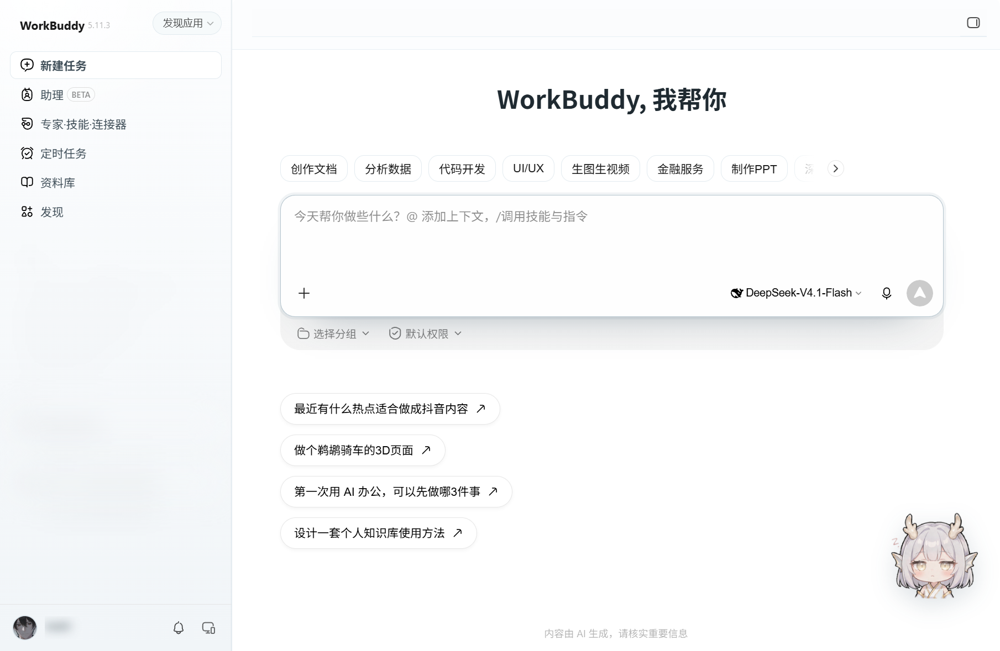

# 雲瀾 · WorkBuddy 皮肤

给 [WorkBuddy](https://www.workbuddy.cn) 桌面端换一套「云雾深山」的浅色主题：素白 / 雾蓝灰 / 松墨，外加一个扒在输入框上的 Q 版白龙娘。

不改安装包、不碰签名，纯 CSS + 运行时注入。



---

## 特性

- **配色**：素白底、雾蓝灰描边、松墨绿主色，衬线中文标题
- **角色挂件**：Q 版白龙娘扒在输入框右上角，6 种表情
  - 待机浮动 → 悬停开心 → 悬停 2.2 秒害羞脸红 + 抖动 → 点击惊讶弹跳 → 闲置 45 秒打瞌睡
- **头像与署名**：可替换成自己的形象和名字（对话署名用纯 CSS 伪元素实现，不破坏宿主渲染）
- **细节**：磨砂输入框、雾气流淌背景、自定义滚动条与选区色
- 覆盖：侧栏 / 对话区 / 输入框 / 气泡 / 表格 / 代码块 / 按钮 / 弹窗 / 设置页

## 原理

WorkBuddy 是 Electron 应用，没有开放换肤接口。本项目通过它的调试端口，在渲染进程里插入一层样式与一个独立浮层节点：

```
WorkBuddy.exe  (WORKBUDDY_REMOTE_DEBUGGING_PORT=9342)
        ↓
inject.mjs  连接 127.0.0.1:9342 的 CDP
        ↓
插入 <style id="byakuru-skin"> + adoptedStyleSheets + 自建浮层节点
```

- 端口只监听本机回环
- 注入内容只存在于内存，**重启即失效**——所以需要启动器
- 不修改 `app.asar`，不影响更新

## 快速开始（Windows）

前置：Node.js 18+（或用 WorkBuddy 内置 node）、WorkBuddy 桌面端。

**推荐**：把 `launch-skinned.vbs` 发一个快捷方式到桌面，以后都从它启动。

1. 右键 `launch-skinned.vbs` → 发送到 → 桌面快捷方式
2. 双击桌面快捷方式
3. 脚本先拉起隐藏守护，再开 WorkBuddy；约 20 秒后界面变云雾配色

`launch-skinned.vbs` 自动定位脚本目录与 Node/WorkBuddy 路径，仓库可放任意位置。守护独立于脚本存活：WorkBuddy 重启、切换任务、新开窗口后皮肤都会自动补上，不用再手动补注入。

**其它入口**：
- `start-skinned.bat`：关掉并重启 WorkBuddy + 注入（会重启一次，约 40 秒）
- `apply-now.bat`：已登录状态下给运行中的实例补注入，不重启
- 开机自启：把 `launch-skinned.vbs` 的快捷方式放进「启动」文件夹

**还原**：双击 `restore.bat`，或直接从原始快捷方式打开 WorkBuddy。

## 目录

```
├─ theme.css            全部样式（颜色、字体、挂件、表情切换）
├─ inject.mjs           注入器 + 守护进程（事件驱动，低开销）
├─ launch-skinned.vbs   推荐入口：先起守护再开 WorkBuddy
├─ audit.mjs            注入后抓 DOM 快照与截图，用于排错
├─ start-skinned.bat    重启 WorkBuddy 并注入
├─ apply-now.bat        给运行中的实例补注入
├─ restore.bat          还原官方外观
└─ assets/
   ├─ portrait-corner.png  对话区右侧的半透龙娘底纹
   ├─ ava-me.png           助手头像
   ├─ ava-user.png         用户头像
   └─ expr/face1-6.png     Q 版六表情（透明底）
```

## 自定义

改完存盘，跑 `node inject.mjs --once` 即时生效，不用重启。

| 想改 | 改哪里 |
|---|---|
| 主色 | `theme.css` 顶部 `--cb-accent` |
| 侧栏 / 对话区底色 | `.conversation-list` / `.conversation-shell` 的 `background` |
| 角色底纹浓淡 | `assets/portrait-corner.png` 的透明度 |
| 挂件大小 / 位置 | `#byakuru-mascot` 的 `width`，以及 `inject.mjs` 里 `place()` 的偏移量 |
| 表情触发时机 | `inject.mjs` 里 `setTimeout(..., 2200)` / `45000` |
| 头像与署名 | 替换 `assets/ava-*.png`；名字改 `theme.css` 的 `::after{content:...}` |

> `theme.css` 里的 `__ASSET__` 是资产占位符，由 `inject.mjs` 在运行时替换成绝对 `file://` 路径。

## 已知限制

- **重启失效**：注入在内存里。`launch-skinned.vbs` 已带守护，从它启动即可自动恢复；若想开机常驻，把它的快捷方式放进「启动」文件夹。改 `app.asar` 不推荐（破坏签名、升级即失效）
- **依赖调试端口**：必须在启动时带上 `WORKBUDDY_REMOTE_DEBUGGING_PORT`
- **类名会变**：WorkBuddy 升级后 UI 类名可能调整，届时需要补选择器
- **只适配浅色**：请把 设置 → 外观 切到「浅色」，深色模式下会打架
- 未逐页验证：设置页、右侧结果区只做了通用规则，细节可能需要补

## 许可

MIT。与 WorkBuddy 官方无关，属社区自定义，仅供学习交流。
